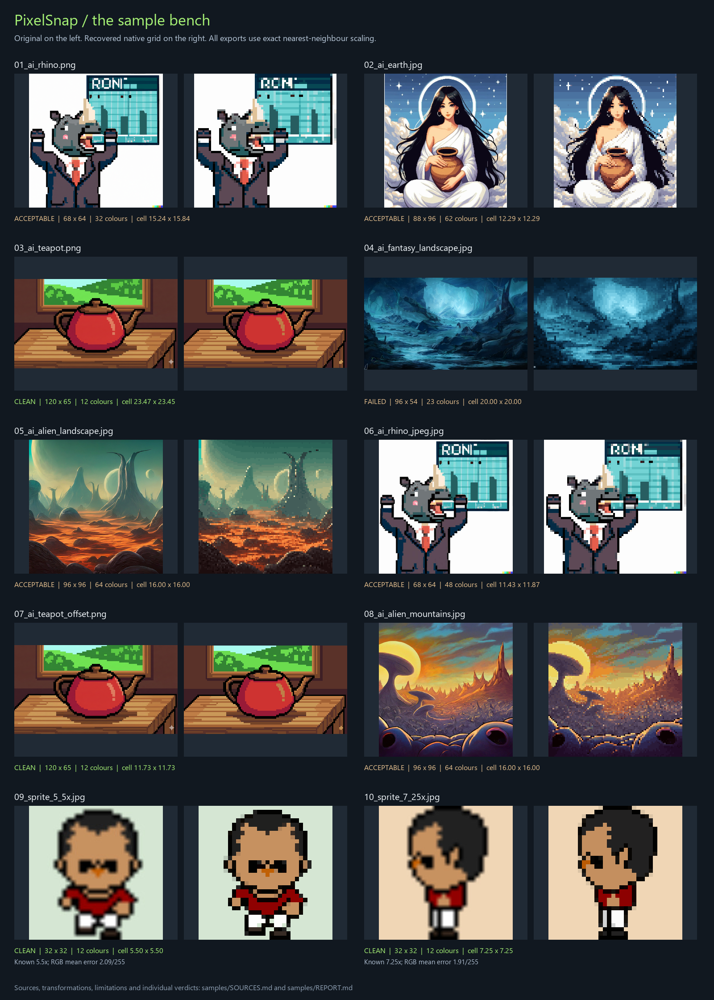

# PixelSnap

Turn blurry, off-grid “pixel art” into a true low-resolution grid: one solid colour per pixel, a compact palette, and exact nearest-neighbour exports. Runs locally on the CPU. No accounts, API keys, telemetry, or runtime network requests.



## Start with one click or one command

**Windows:** double-click `run.bat`, or run `./run.bat` from PowerShell. No preinstalled Python is required: the launcher finds uv, or installs uv 0.13.6 using [Astral's official installer](https://docs.astral.sh/uv/getting-started/installation/), then obtains Python 3.12 if needed. Setup uses a per-user cache, handles source paths with spaces, validates imports on every launch, and rebuilds stale environments when the source/dependency digest changes. Setup is locked and a completion marker is written only after installation succeeds. No administrator rights are needed.

**macOS/Linux:** from the extracted folder, run `sh ./run.sh` (or `sh ./install.sh`). The same uv/Python bootstrap and per-user cache are used. `curl` and an internet connection are needed for first setup. The POSIX script is provided but has not been executed on macOS in this Windows validation run.

With [uv installed](https://docs.astral.sh/uv/getting-started/installation/), either platform can use these one-liners from the project folder:

```sh
uvx --python 3.12 --from ".[web]" pixelsnap serve
uvx --python 3.12 --from . pixelsnap snap "input.png" -o "out" --json
```

Replace `.` with an absolute checkout path or a Git URL containing this package; no published PyPI distribution is assumed. To install persistently: `uv tool install --python 3.12 ".[web]"`, or `python -m pip install ".[web]"` in your own virtual environment. Core installs include NumPy, Pillow, SciPy and the official MCP SDK. Flask/Waitress are in `[web]`; `[mcp]` remains a compatibility extra.

First setup downloads dependencies. Subsequent unchanged cached launches work offline. Network/proxy/certificate errors are printed and return code 3; rerun after correcting them. The app binds only to `127.0.0.1`. It prefers port 18765, automatically chooses a free port if occupied, and opens the actual URL after a successful health check. `run.bat --no-browser --port 0 --json` prints a ready event with the selected URL. An explicit occupied fixed port fails accurately. Keep the console open; Ctrl+C stops the server.

Drop an image into the upload box, or try the included example. Processing starts automatically and settings update the preview after a short debounce. **Target grid** forces 16, 24, 32, 48, 64, 96, or 128 pixels on the long side, preserving aspect ratio to the nearest pixel. Auto-detect remains the default. Expand **Advanced grid controls** for manual cell size, offsets, cell height, and drift correction. Target resolution takes precedence over manual alignment.

Compare before/after side by side, zoom in, then drag or use arrow keys to pan; Home centres the preview. Grid lines are a preview overlay and never appear in exports. **Download PNG** uses the selected export size; native PNG, comparison PNG and palette HEX are secondary downloads. Fit-to-512/1024 uses the largest whole-number scale within that size: a 96 px grid fits to 480 px, keeping every output pixel evenly sized.

Choose automatic colours (optionally capped at 2–64), PICO-8, Game Boy, NES, Endesga 32, Sweetie 16, CGA (cyan/magenta/white/black), or black-and-white. **Custom palette** accepts pasted hex colours or a `.hex` / GIMP `.gpl` file with 2–64 unique colours. Ordered Bayer dithering is optional and off by default. Palette presets and custom palettes override the automatic colour cap.

A weak or nonexistent grid gets a warning and a roughly 96-pixel-long-side fallback. Increase cell size for a chunkier result; reduce it to keep more detail. Background removal only removes a dominant flat colour connected to the border. Cleanup is optional because single-pixel eyes and stars can be intentional.

## CLI and automation

```sh
pixelsnap --version
pixelsnap snap input.png -o out --json
pixelsnap snap "art/*.png" "more/*.jpg" -o out --jsonl
pixelsnap snap art -o out --recursive --colors 16
pixelsnap snap input.png -o out --cell 6 --cell-y 8 --offset-x -2 --offset-y 1
pixelsnap snap input.png -o out --target-size 48 --palette sweetie16 --fit 512 --artifacts native,upscaled,comparison
pixelsnap snap input.png -o out --palette-file my-colours.gpl --dither
pixelsnap snap input.png -o out --custom-palette "#172038, #f5c267, #ffffff"
pixelsnap snap - -o - --cell 6 --metadata-file result.json < input.png > native.png
python -m pixelsnap snap input.png -o out --json
```

Binary redirection above is for POSIX shells or `cmd.exe`; older Windows PowerShell pipelines do not preserve native binary streams. stdin is limited to 25 MiB, accepts exactly one image, and stdout contains exactly one PNG. Binary stdout cannot be combined with JSON/JSONL. Metadata goes only to an explicit sidecar in that mode.

`pixelsnap snap` defaults to native PNG plus an info JSON sidecar. Add `--artifacts native,upscaled,comparison` for all exports. The old `pixelsnap INPUT -o OUT` and `python -m pixelsnap INPUT ...` spellings and all old flags remain aliases, defaulting to all three images. `--fit 512|1024` overrides `--scale 1..32`. Auto cell search spans 2..64 source pixels; manual `--cell`/`--cell-y` allow 1..128, offsets -128..128. `--colors 2..256` is a ceiling; presets override it. Target sizes are 16, 24, 32, 48, 64, 96 and 128. Folder recursion is opt-in; recursive `**` globs require `--recursive`. Directory symlinks are not followed; an output subtree is excluded from folder traversal.

Exports are `STEM_native.png`, optional `STEM_xN.png` and `STEM_comparison.png`, and `STEM_info.json`. Duplicate stems get unique filename/hash suffixes. Existing files are refused unless `--overwrite` is explicit. Destination locks prevent simultaneous writers; staged artifacts are published before the info sidecar. An interrupted process can leave a `.STEM.lock`; remove that lock only after confirming no matching writer is running. A corrupt, missing, or oversized input fails that item and the remaining batch continues. PNG, JPEG, WebP, BMP, TIFF and GIF are supported; animation uses its first frame.

`--json` emits one object; `--jsonl` emits one typed result per input and a typed summary. stdout has no prose. The schema includes `schema_version: 1`, `app_version`, `results`, and `summary`. Each result has `input`, `status`, absolute `outputs` paths (including `info`), `metadata` (grid, palette, options, coordinates, warnings), `timings_ms`, and `error: null` or `{code,message,retryable}`. Operational timings are separate from deterministic metadata. Usage errors also emit JSON when requested.

Exit codes: **0** all inputs succeeded; **1** one or more input/output failures; **2** invalid arguments/options or no matching inputs; **3** startup/system failure; **130** interruption. Logs and human output go to stderr. `--debug` exposes startup tracebacks. Normal conversion performs no network requests and never opens a browser.

## Python API

Install PixelSnap into the Python environment that runs your script (`python -m pip install .`); a uvx/pipx installation does not add a library to other environments.

```python
from pixelsnap import snap, Options, save_result
result = snap("input.png", Options(colors=16))
result.native.save("native.png")
paths = save_result(result, "out", "sprite")
```

`snap(source, options=None, *, artifacts=("native",))` accepts a path, bytes, a binary file-like object or a PIL image. Caller-owned streams/images are not closed. It returns a detached native image and metadata; unrequested `upscaled` and `comparison` images are `None`. `process_image` remains the compatibility API that renders all artifacts. Native-only calls are not subject to an unrequested upscale limit. Invalid options raise `ValueError`; oversized input raises `InputTooLarge` with `code="input_too_large"`.

Unsigned 16-bit images are rounded over the full 0..65535 range; mode `I` follows that same range policy. Float mode `F` requires finite 0..1 values. Out-of-range numeric images are rejected. Alpha is reduced to binary coverage; invisible RGB cannot influence visible colours. Input limit: 20 MP and 8192 pixels per side; native output: 1 MP; requested upscaled output: 32 MP. Large inputs still need several hundred MB of RAM. Results are deterministic within the same numerical-library environment; bit-identical results across library versions are not promised.

## PixelSnap v2: versions, edge cleanup and exports

`edge_cleanup="smart"` is the default. `off` reproduces the v1 sampling/cleanup path; `strong` is more aggressive. Smart uses alpha-weighted, centre-biased two-cluster sampling on mixed cells, then suppresses low-population OKLab transition colours with local endpoint support. Flat areas and local extrema (eyes/highlights/stars) are protected. Strong and the opt-in orphan cleanup can remove intentional small details; review Clean before using it. Dither intentionally creates texture and bypasses transition cleanup.

The detector and bilinear geometry inversion are unchanged. A transition pixel is a minority palette colour near the OKLab segment of two more populous neighbouring colours, outside a flat interior. Smart uses 0.008 OKLab residual tolerance, a 2:1 population ratio and a 3-neighbour flat guard. In images where two endpoint colours cover at least 90% of pixels, small interpolation clusters need only one endpoint locally. The metric is diagnostic, not a claim that every remaining artefact is detectable.

`pixelsnap/presets.json` is the single preset definition: Faithful, Clean, Icon 32, Sprite 64, Retro, Game Boy, 1-bit, Poster 128. The browser imports this JSON directly from the public Python package. The public package is a byte-for-byte distribution copy of the canonical package.

```python
from pixelsnap import variants
versions = variants("input.png", presets=["faithful", "clean", "Icon 32"])
# Each item: preset, label, native (Pillow RGBA), width, height, palette, meta.
# Grid detection happens once; target-size variants resample without redetection.
```

```sh
pixelsnap snap input.png -o out --preset clean --edge-cleanup smart --json
pixelsnap snap input.png -o out --svg --palette-files
pixelsnap snap input.png -o out --pack out/sprite.zip
pixelsnap snap input.png -o out --pack
```

`--pack` writes a folder (`out/input_pack` by default) or a `.zip`: native PNG, aspect-preserving nearest-neighbour fits at long-side 16/32/64/128, an exact 8x preview, run-length SVG, HEX and GPL palettes. Upscaling fits can have unequal pixel widths when dimensions do not divide evenly; the native PNG and 8x preview always preserve exact grid geometry. Existing files are refused unless `--overwrite` is supplied. Python helpers live in `pixelsnap.exports` (`svg`, `palette_hex`, `palette_gpl`, `nearest_fit`, `pack_files`, `save_pack`).

## MCP stdio

After the v2 integration is published to the public repository, launch directly with one line:

```sh
uvx --from "git+https://github.com/ZirkoMirkoLabs/fun#subdirectory=desktop/pixelsnap" pixelsnap mcp
```

This requires uv and Git. The official `mcp>=1.12,<2` SDK is installed automatically; no extras or API keys are required. The v1 SDK is deliberately pinned for Python 3.10 compatibility. The local equivalent used for verification is:

```sh
uvx --from "G:/ClaudeOctober/XClaude/fun/desktop/pixelsnap" pixelsnap mcp --input-root "G:/ClaudeOctober/XClaude/pixelsnap/samples/input" --output-root "G:/tmp/pixelsnap-v2/mcp"
```

Choose real input/output directories in the examples below. `uvx` must be in the client's PATH; otherwise use its absolute executable path. The first isolated Windows launch can spend more than 120 seconds installing and importing dependencies; allow a longer initial startup timeout. If a client times out, run the same uvx command with `--version` instead of `mcp` once, then retry. Cached stdio launches were verified.

### Claude Code

```sh
claude mcp add --transport stdio pixelsnap -- uvx --from "git+https://github.com/ZirkoMirkoLabs/fun#subdirectory=desktop/pixelsnap" pixelsnap mcp --input-root "G:/art" --output-root "G:/snapped"
```

See [Claude Code's local stdio configuration](https://code.claude.com/docs/en/mcp).

### Claude Desktop

Add to `claude_desktop_config.json` (Settings > Developer > Edit Config):

```json
{
  "mcpServers": {
    "pixelsnap": {
      "command": "uvx",
      "args": ["--from", "git+https://github.com/ZirkoMirkoLabs/fun#subdirectory=desktop/pixelsnap", "pixelsnap", "mcp", "--input-root", "G:/art", "--output-root", "G:/snapped"]
    }
  }
}
```

See the [official local MCP setup guide](https://modelcontextprotocol.io/docs/develop/connect-local-servers).

### Codex

Add to `~/.codex/config.toml`:

```toml
[mcp_servers.pixelsnap]
command = "uvx"
args = ["--from", "git+https://github.com/ZirkoMirkoLabs/fun#subdirectory=desktop/pixelsnap", "pixelsnap", "mcp", "--input-root", "G:/art", "--output-root", "G:/snapped"]
startup_timeout_sec = 300
tool_timeout_sec = 120
```

See [official OpenAI MCP configuration](https://developers.openai.com/codex/mcp).

### Cursor

Put the same `mcpServers` JSON shown for Claude Desktop in `.cursor/mcp.json` (project) or `~/.cursor/mcp.json` (global). See [Cursor's MCP configuration](https://prod.cursor.com/help/customization/mcp).

### Tools and path policy

- `snap_image(path, options?, artifacts?, include_image=false)` accepts `preset` and `edge_cleanup` in options. Explicit options override the preset. It returns unique output paths and metadata; `include_image=true` adds native PNG MCP image content when the native artifact is selected.
- `snap_variants(path, presets?)` detects once and exports selected versions (all eight by default), with palette, metadata and timings.
- `batch_snap(path, options?, recursive=false)` accepts a folder or glob and isolates per-file failures.
- `list_presets()` and `list_palettes()` expose supported bundles and palette colours. `list_capabilities()` reports configured roots and limits.

Relative inputs resolve inside `--input-root`; paths escaping it are rejected, including resolved symlinks. Outputs have unique filenames. Defaults are current directory for input and `./out` for output. Calls are serialized, logs go to stderr, stdout is protocol-only, and there is no network listener. Image processing is local; uv may download dependencies on first setup.

## HTTP API and preview cache

`GET /api/v1/health` reports versions and limits. `POST /api/v1/snap` accepts multipart `image`, JSON text `options`, and optional comma-separated `artifacts` (default native), returning the same envelope with in-memory PNG data URLs in `outputs`. `/api/process` remains compatible with the UI. Size violations return 413, invalid inputs/options 400, busy 429 with `Retry-After: 1`, and unexpected failures 500 with server-side logging. API 404/405 responses are JSON.

The cache holds one decoded source and sampled grid, keyed by content SHA-256 and every detection/sampling option. Palette, scale, dithering, background and cleanup changes reuse it. A new input/grid replaces it. The UI comparison download is rendered on demand; expired previews return 404. No upload or cache is deliberately persisted to disk; the HTTP framework may spool request bodies temporarily.

## Reconstruction

Windowed, oversampled FFT candidates from alpha-aware gradient and second-derivative projections are refined continuously over 2–64 pixel pitches, with cross-axis agreement and independent phase fits. Curvature detects centres in bilinear enlargements. Confident edge grids can adapt to modest smooth drift.

Each logical cell uses nine samples from its inner 24%, with alpha-weighted colour medians and separate coverage. Exact existing palettes are preserved when they fit the requested ceiling. For confidently identified bilinear enlargements, a small tridiagonal solve reverses the known centre-sampling mixture before palette fitting. Weighted, deterministic k-means in OKLab selects up to 64 colours automatically and merges near-duplicates. PICO-8 and Game Boy presets, background removal, and conservative orphan cleanup are optional. Upscaling repeats pixels exactly; partial edge cells are kept when their centres lie inside the image.

A single grid cannot reconstruct mixed pixel sizes, rotated/perspective grids, or lost detail. Repeated features and JPEG blocks can mislead detection. Confidence is a heuristic, not a probability. Palette reduction changes colours; this is not a perfect inverse of every resize filter.

## Validation and licences

See [individual verdicts and measurements](samples/REPORT.md), [source URLs and licences](samples/SOURCES.md), and [the full contact sheet](samples/contact_sheet.png). The ten cases include deliberate degradation variants and three smooth landscape negative controls; they are not ten independent pixel-art originals.

```powershell
python -m pip install -r requirements-dev.txt
python -m pytest -q
# Optional browser smoke check, with the app already running:
python -m playwright install chromium
python tools/verify_browser.py
```

Tests cover fractional resizing with blur/JPEG noise, known phase, non-square cells, palette limits, exact upscaling, transparency, cleanup, invalid inputs, no-grid warnings, and API uploads. Browser checks cover drag/drop, downloading, presets, background removal, manual settings, and 1440/900/390-pixel layouts. Screenshots are in `samples/qa/`.

App code is MIT-licensed. Sample images retain their documented CC0 or Wikimedia public-domain declarations. Only the development utility `tools/fetch_samples.py` makes explicit download requests; the app never imports it.

## Optional Windows one-folder build

```powershell
python -m pip install -r requirements-build.txt
python -m PyInstaller --noconfirm PixelSnap.spec
.\dist\PixelSnap\PixelSnap.exe
.\dist\PixelSnap\PixelSnap.exe snap input.png -o out --json
```

Distribute the entire `dist/PixelSnap` folder. With no arguments the executable opens the local UI; `snap` runs the CLI. The console is intentional so errors and Ctrl+C remain available. Static assets and numerical native libraries are bundled; the MCP SDK is excluded (use the Python installation for MCP). Build on the target OS; this is not a signed installer or macOS app. See `samples/ACCEPTANCE.md` for this run's actual build and validation status.
