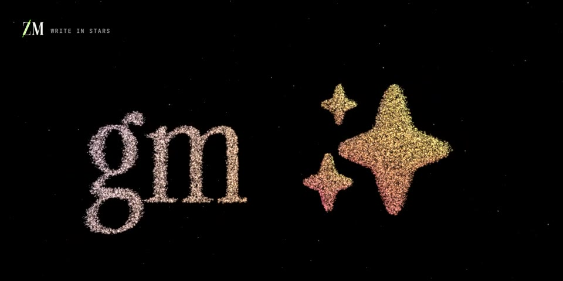

# Write in Stars

Type anything and watch a galaxy spell it. Drop in an image and the stars become it.

**Play:** [zirkomirko.com/fun/projects/write-in-stars](https://zirkomirko.com/fun/projects/write-in-stars/)

## What you can do

- **Type** a word, a phrase or emoji (up to 28 characters). The galaxy unravels and its stars fly into the text, which wraps to fit your screen. Emoji keep their colours.
- **Image:** pick, drop or paste a picture and the stars become it. Plain backgrounds are removed automatically. The image never leaves your device.
- **Touch:** move through the stars to push them away, tap for a shockwave, scroll to zoom. **Scatter** and **Gather** switch between the galaxy and your words.
- **Remix:** palette, arms, twist, spread, star count, star size and rotation.
- **Share:** save a 6-second MP4 of the galaxy turning into your words, save a PNG, or copy a link that reproduces it.

## How it works

- [three.js](https://threejs.org) r186 `WebGPURenderer`, which falls back to WebGL 2 automatically.
- Up to 70,000 stars in one instanced sprite mesh. Galaxy positions are pure [TSL](https://threejs.org/docs/#api/en/nodes/tsl) from `instanceIndex` + hash noise, driven by uniforms, so a new galaxy is just new uniform values.
- Text and images are drawn to an offscreen canvas and sampled into per-star target positions and colours. The GPU blends galaxy ↔ formation and swirls stars from one formation to the next.
- The pointer push and the shockwave are stateless shader effects: a ray in the stars' local space, and an expanding ring.
- `gen.js` turns any string into galaxy parameters (type, arms, twist, palette), so the same words always give the same galaxy.
- Clips are encoded frame by frame with WebCodecs + [mp4-muxer](https://github.com/Vanilagy/mp4-muxer) at exactly 30 fps, with MediaRecorder as a fallback.
- Encoded images are limited to 20 MiB and validated before decoding (16 MiPixels, 8192 pixels per side). PNG, JPEG, static WebP and bounded GIF inputs are supported; SVG and animated WebP are rejected. Only one image decodes at a time.
- The UI paints before staged engine imports. Sampling yields between short batches so typing and controls stay responsive. All vendor code remains self-hosted and hash-pinned.

## Files

| File | Role |
|---|---|
| `index.html` | markup, import map, fonts |
| `main.js` | renderer, TSL star material, sampling, interaction, exports |
| `gen.js` | deterministic string → galaxy parameters |
| `boot.js` | paint-first, staged engine loading |
| `image-input.js` | raster signature/dimension checks before decode |
| `style.css` | UI |
